<div align="center">

# PVE Panel

### A modern self-service portal for Proxmox VE

Give users a clean, secure interface to manage **only their own virtual machines and containers** — without exposing the Proxmox VE interface or API credentials.

<sub>A fork of <a href="https://github.com/sebastianflint/pve-panel">sebastianflint/pve-panel</a> (1.11.0), extended towards a complete self-service cloud: billing, plans, public IPs, storage, support desk and fleet operations.</sub>

[](https://www.proxmox.com/)
[](https://nodejs.org/)
[](https://www.docker.com/)
[](#-authentication)
[](https://github.com/hawaianblue21/pve-panel/pkgs/container/pve-panel)
[](https://github.com/hawaianblue21/pve-panel/releases)
[](https://github.com/hawaianblue21/pve-panel/actions/workflows/docker-publish.yml)
[](https://github.com/hawaianblue21/pve-panel/actions/workflows/codeql.yml)
[](https://hawaianblue21.github.io/pve-panel/)
[](#-ai-assisted-development)

[Fork](#-about-this-fork) ·
[Features](#-features) ·
[Screenshots](#️-screenshots) ·
[Architecture](#️-architecture) ·
[Quick Start](#-quick-start) ·
[Networking](#-customer-network-isolation) ·
[Authentication](#-authentication) ·
[Deployment](#-deployment) ·
[Versions](#-versions--updates) ·
[Security](#️-security-model) ·
[AI use](#-ai-assisted-development) ·
[Documentation](https://hawaianblue21.github.io/pve-panel/)

</div>

---

## Overview

**PVE Panel** turns a Proxmox VE environment into a lightweight self-service platform.

Users receive a dedicated portal where they can manage assigned servers, open consoles, view usage data, work with snapshots, and — when enabled — provision new systems from administrator-approved templates.

Administrators retain control over templates, quotas, ownership, networking, authentication, and lifecycle operations.

The browser **never communicates directly with Proxmox VE** and never receives the Proxmox API token.

```text
┌──────────────────────┐
│      Customers       │
└──────────┬───────────┘
           │ HTTPS :3000
           ▼
┌──────────────────────────────────────────────┐
│                  PVE Panel                   │
│                                              │
│  Customer Portal        Admin Interface      │
│  :3000                  :3001                │
│                         localhost by default │
│                                              │
│  Fastify · SQLite · Jobs · Auth · Audit      │
└──────────────────────┬───────────────────────┘
                       │ Proxmox API Token
                       ▼
              ┌──────────────────┐
              │   Proxmox VE     │
              │ VM · LXC · SDN   │
              └──────────────────┘
```

The customer and administration portals run as **separate web servers** in the same process. They use separate session cookies and signing keys, and the customer-facing server does not expose administrator routes.

> 📘 This README is the overview. Every setup step, permission, firewall rule and troubleshooting tip is in the **[documentation](https://hawaianblue21.github.io/pve-panel/)**.

---

## 🔱 About this fork

This repository (**[hawaianblue21/pve-panel](https://github.com/hawaianblue21/pve-panel)**) is a fork of
**[sebastianflint/pve-panel](https://github.com/sebastianflint/pve-panel)**, taken at version **1.11.0**. The upstream
project provides the core: customer and admin portals, VM and container control, console, provisioning (Linux
cloud-init and Windows sysprep), snapshots, network isolation, WireGuard and Tailscale, OIDC, 2FA and passkeys, Windows
updates, server expiry and the Docker setup. The fork adds:

| Area | Added in this fork |
|---|---|
| Access & capacity | Roles for administrators (RBAC), datacenters, resource pools with shared caps, GPU passthrough and vGPU, **several Proxmox clusters** |
| Network | Public IPv4 pools (IPAM) with anti-spoofing and reverse DNS, **optional IPv6 /64 per address** (global switch) |
| Storage | Block volumes with tiers, SeaweedFS S3 object storage with per-customer IAM, **read-only buckets** |
| Servers | **Automatic snapshots** (daily or weekly, including attached volumes), Linux package updates |
| Commerce | Plans with monthly prices, wallet, renewals, invoices with PPN, Xendit, Midtrans and bank transfer |
| Support | Ticket desk (L1 / L2 / L3), knowledge base / help center, optional Zammad sync, AI assistant |
| Operations | Overview dashboard, Hosts with maintenance mode, Jobs with **retry**, update fleet and rollouts in rings with **maintenance windows** and **Check now** |
| Integrations | API tokens for customers and administrators, Google / Microsoft / GitHub sign-in, white-label branding and appearance |

What that means in practice:

- **Container image**: `ghcr.io/hawaianblue21/pve-panel`. Pushes to `main` publish the tag `edge`; `latest` and version
  tags appear only after a release tag (`git tag v1.12.0 && git push --tags`). Until then set
  `PANEL_IMAGE=ghcr.io/hawaianblue21/pve-panel:edge`. A new GHCR package is private by default: make it public under
  the repository's **Packages** settings, or `docker login ghcr.io` on the host.
- **Documentation website**: `https://hawaianblue21.github.io/pve-panel/` is built from `website/` by the Documentation
  workflow and is online once GitHub Pages is enabled (**Settings → Pages → Source: GitHub Actions**). Pages that
  describe fork features are summarized in this README; `docs/design/README.md` tracks the UI status per screen.
- **Update check**: the panel compares its version with the latest release of this repository (`package.json`
  `repository`), not upstream's.
- **Testing**: the fork's features are covered by the automated suite (API and browser tests) against simulated
  Proxmox, payment gateways, SeaweedFS, PowerDNS, Zammad and LLM services. They have **not yet been validated against a
  real Proxmox cluster**; do that before production use (see [Recommended validation](#-recommended-validation)).
- **License**: neither upstream nor this fork contains a license file. Clarify the terms with the upstream author
  before redistributing or offering the software commercially.

---

## 🤖 AI-assisted development

PVE Panel was built with substantial help from an AI assistant (**Claude by Anthropic**). To be transparent about what that means:

**Created with AI assistance**

- most of the source code (backend, customer and admin portals, scripts)
- the Docker, Compose and GitHub Actions setup
- the documentation, the README and the [documentation website](https://hawaianblue21.github.io/pve-panel/)
- automated tests during development, largely against simulated Proxmox, guest-agent, SMTP and WireGuard environments and a certified test OpenID provider
- the screenshots, taken from such a test environment with sample data

**Done by the maintainer**

- defining the requirements and deciding on features and design
- running and testing the panel against a real Proxmox VE environment and reporting problems, which were then fixed
  (upstream features; the fork's additions are so far tested against simulated environments, see [About this fork](#-about-this-fork))
- publishing, versioning and operating the project

**What this means for you**

- An automated test suite (unit, API and browser tests) runs on every change, and releases are only published when it passes. It runs against a **simulated** Proxmox, so it can't replace validating your own environment.
- Not every feature has been tested in every real-world combination — especially provider-specific setups (OIDC providers, mail servers, NAS models, Windows editions).
- AI-generated code can contain mistakes, including security-relevant ones. Review the code and the [security model](#️-security-model) before using PVE Panel in production, and validate customer isolation yourself (see [Recommended validation](#-recommended-validation)).
- Issues and pull requests are reviewed and handled by the maintainer.

---

## ✨ Features

### Customer self-service

- Start, shut down, restart and force-stop assigned systems
- Manage both **QEMU VMs and LXC containers**
- Live **network map** of the customer's private network, servers and VPN
- View live status and guest information, with Windows / Linux recognition
- Display CPU, memory, disk and network usage graphs
- Create, restore and delete snapshots (optionally including RAM), and schedule **automatic snapshots** (daily or weekly, keeping the last N; attached volumes included)
- Launch an integrated browser console
- Create new servers from administrator-approved templates
- Reinstall self-created servers from a template (same name, size and network address)
- Resize self-created servers within their plan (CPU, memory, disk)
- Install Windows updates with one click (optional snapshot first, automatic restarts)
- Install Linux package updates (apt / dnf) the same way: security only or everything, restart reminder after a new kernel
- Sign in with Google, Microsoft (work or school accounts) or GitHub, and link or unlink them under Account
- Choose their own color scheme and light / dark mode (when the panel owner allows it)
- Open **support tickets** (optionally about one of their servers), follow the conversation and get answers by email
- Search the **help center** (knowledge base) and rate articles
- **Public IPv4** for their servers, optionally with an **IPv6 /64** each, with reverse DNS
- **API tokens** with chosen permissions for scripts and integrations
- **Storage**: block volumes (create, attach, detach, move between servers, enlarge) and S3 object storage buckets with access keys, optionally **read-only**
- Ask the **AI assistant**: answers from the help center and their own servers and tickets, hands over to a ticket
- **Plans**: create servers from plans (size and monthly price), pay the first period from the wallet, move up to a larger plan for the difference
- **Billing**: wallet with top-ups, renew servers for 1, 3, 6 or 12 months (with discounts), auto-renew from the wallet, printable invoices with PPN; pay by wallet, **Xendit**, **Midtrans** or bank transfer
- Delete self-created servers
- View provisioning progress and actionable failure messages
- Manage personal VPN devices
- Connect servers to a personal Tailscale network
- Manage their own two-factor authentication and passkeys
- See which panel version they're using

### Administrator experience

- Create and manage customer accounts
- Assign existing Proxmox VMs or containers to users
- Configure provisioning quotas and limits
- Publish selected templates
- Start, stop, restart and delete customer-owned servers
- Review provisioning jobs and failures, and **retry** failed deletions, update runs and automatic snapshots
- Reset passwords and 2FA, require 2FA per user, link/unlink single sign-on
- Review the activity log: filter by who acted (customer, administrator, the panel itself, unknown sign-ins), by kind of action (created, changed, deleted, power, security) or by text; open any event for its full record
- Monitor WireGuard and Tailscale usage
- Delete customers together with their owned infrastructure
- **Overview** dashboard (KPIs, nodes, alerts, latest activity) and **Hosts** with maintenance mode (no new servers on a node)
- Connect **several Proxmox clusters** (connection test, pinned TLS fingerprint, VMID and node conflicts reported)
- **Updates**: fleet view, **Check now** (pending updates per server), rollouts in rings with a failure limit and an optional **maintenance window**
- **Public IPs**: IPv4 pools with reservations, cool-down and PowerDNS reverse DNS, optional **IPv6** prefix per pool
- **Block storage** tiers mapped to Proxmox storages, with a price per GB
- See the running version and whether an update is available
- Configure email (SMTP) in the admin portal and invite users by email
- White-label: product name, logo, browser icon and support link; single sign-on with Google, Microsoft and GitHub
- **Ticket desk**: queues L1 / L2 / L3, priority, status, assignment, internal notes, the customer's servers and recent activity next to each ticket, matching articles
- **Knowledge base**: Markdown articles with drafts and visibility (public, customers, agents only), drafts from solved tickets, and a list of help-center searches that found nothing
- Optional two-way sync with a **Zammad** helpdesk
- **AI assistant** for customers (Claude, or any OpenAI-compatible API incl. local models): settings, usage, and every conversation with what the assistant looked up
- **Plans**: sizes (vCPU, memory, disk, optional GPU) with a monthly price; retire plans without touching their servers; optionally require a plan instead of custom sizes
- **Billing**: invoices with filters (unpaid, transfer reported, overdue), revenue and tax this month, confirm bank transfers, cancel invoices, adjust wallets, fixed prices per server; a *Finance* role
- Give single customers or servers an expiry date: reminders, automatic stop, grace period, deletion
- Role-based access for administrators (owner, operator, resource manager, read-only support, custom roles)
- Datacenters and resource allocation pools: shared caps on vCPU, memory, disk, public IPs, GPUs and object storage
- GPU compute: PCI passthrough and NVIDIA vGPU (mdev) on Proxmox resource mappings
- Object storage on SeaweedFS (S3): per-customer IAM users, buckets, policies and one-time access keys

### Provisioning

PVE Panel supports automated provisioning for both Linux and Windows workloads.

**Linux**

- Cloud-init
- Hostname
- User credentials
- SSH keys
- CPU and memory sizing
- Disk expansion
- DHCP networking
- QEMU Guest Agent integration

**Windows**

- Sysprep-based templates
- Automated OOBE handling
- Administrator password replacement (verified inside Windows)
- Computer rename
- QEMU Guest Agent configuration
- DHCP cleanup and validation
- Windows setup-state detection
- Automatic reboot and readiness checks

---

## 🏢 Several Proxmox clusters

The main cluster is the one in `PVE_URL` (name it with `PVE_CLUSTER_NAME`). Owners connect further clusters in
**Hosts → Clusters**: address, API token (same rights as the main token: the PanelCustomer role on the customers pool)
and TLS, either a certificate from a known CA or the pinned SHA-256 fingerprint of Proxmox's self-signed one (the
connection test shows it; compare with `pvenode cert info`). The token secret is stored encrypted.

```text
                    ┌─ /nodes/<node>/…        → the cluster that has <node>
panel ─ pve.js ─────┼─ /cluster/resources     → all clusters, merged (servers, nodes, storage)
                    ├─ /cluster/nextid        → an ID free in every cluster
                    └─ SDN, status            → each cluster on its own
```

- **Unique names and IDs**: node names must differ between clusters (checked before connecting). A guest whose VMID
  is also used in another cluster is left out and listed, until it is given a free ID in Proxmox.
- **Servers** are cloned in the cluster of their image; a datacenter's nodes are used only if they belong to that
  cluster. Offer an image (template) per cluster.
- **Customer networks**: the customer's VNet is created on each cluster where they have servers (same name and
  subnet, a separate segment per cluster). The VPN gateway reaches the main cluster's.
- **Console, power, volumes, public IPs, updates** work on any cluster; existing guests of a new cluster are assigned
  to customers in **Servers** as usual.
- **Unreachable or disabled cluster**: its nodes show their last known state, the overview raises an alert, and the
  panel never drops a server record (or frees its addresses) because the server is out of sight.

---

## 📊 Admin overview and hosts

The admin portal opens on **Overview**: guests running and stopped, nodes online, revenue and overdue invoices, open
tickets and public IPv4 use, each tile opening its tab; every node with CPU, memory and storage; alerts (node
unreachable, memory or storage at 85 % or more, no quorum, failed setups, transfers to confirm, overdue invoices,
urgent tickets, IP pools almost full, held addresses); and the latest activity. Each administrator sees only what
their role may read.

**Hosts** lists the nodes of the Proxmox cluster with quorum, PVE version, kernel, uptime, load and storage. A node
that can't be reached shows its last reported state. **Maintenance mode** (permission `hosts.write`) keeps new servers
off a node: they are placed on another node of its datacenter; servers already on it keep running.

---

## 🧩 Access control, resource pools, object storage & GPUs

### Role-based access (admin portal)

Every administrator has a **role**; a role is a set of permissions, and the server checks the permission of
every admin API request (`src/rbac.js`). Routes that aren't mapped need `rbac.write`, so a forgotten mapping
fails closed.

| Built-in role | Can |
| --- | --- |
| **Owner** | Everything, including administrators and roles |
| **Operator** | Customers, servers, network, tickets and the knowledge base; reads everything else (OS templates and settings too) |
| **Resource manager** | Resource pools, datacenters, object storage, GPUs; reads everything else |
| **Support agent** | Tickets and the knowledge base; reads everything else |
| **Support (read-only)** | Sees everything, changes nothing |

**OS templates** and **panel settings** (email, sign-in providers, branding, appearance, updates, expiry) can only be
changed by owners, unless a custom role is given `templates.write` or `settings.write`.

Custom roles are made in **Access**. Administrators created at first start or on the command line are owners;
administrators made in the panel start as **Operator**. The last owner can't be demoted, removed or deleted.

### Datacenters and resource allocation pools

A **datacenter** is a named set of Proxmox nodes (one node belongs to one datacenter) with an optional target
storage. New servers are cloned onto a node of the chosen datacenter (`target` of the full clone).

A **resource pool** is a shared envelope for several customers (a tenant organisation, a department, a reseller).
It caps the **total** of its members, on top of each customer's own limits:

| Pool limit | Empty | 0 | Above 0 |
| --- | --- | --- | --- |
| vCPU, memory, disk | no cap at pool level | none allowed | total cap |
| Public IPv4 | no cap at pool level | none allowed | up to N addresses (their IPv6 /64s don't count) |
| GPUs | **not included** | not included | up to N GPUs |
| S3 buckets / S3 GB | **not included** / no GB cap | not included | up to N |

Pools also list the datacenters and GPU profiles their members may use (none ticked = all).
Checked on create and resize; `GET /api/account` tells customers which datacenters and GPUs they can choose.

### GPU compute (passthrough and vGPU)

GPUs build on Proxmox **PCI resource mappings** (Datacenter → Resource Mappings → PCI Devices, Proxmox VE 8+).
A GPU profile points at one mapping:

- **Passthrough**: a whole device of the mapping → `hostpciN: mapping=<id>[,pcie=1]`
- **vGPU / mediated device**: a slice of the mapping's device (enable *Use with Mediated Devices* on the
  mapping) → `hostpciN: mapping=<id>,mdev=<type>` (e.g. `nvidia-660`)

`pcie=1` is only added when the guest already uses the q35 machine type; the panel never changes a guest's
machine type. GPUs are attached to stopped servers, counted against the owner's pool, kept across a reinstall,
and free capacity comes from the mapping (passthrough) or Proxmox's mdev availability (vGPU).

Extra Proxmox permissions for the panel's token:

```
pveum role add PanelGpu --privs "Mapping.Audit Mapping.Use Sys.Audit VM.Config.HWType"
pveum acl modify /mapping/pci --users panel@pve --roles PanelGpu
pveum acl modify /nodes --users panel@pve --roles PanelGpu
```

### Object storage on SeaweedFS (S3)

Configured in **Object storage**: the S3 endpoint (`weed s3` / `weed server -s3`, port 8333; the IAM API is
embedded there), an admin access key and secret (encrypted at rest, never shown again), a public endpoint for
customers and a bucket prefix. The panel signs requests with AWS Signature V4 and:

- creates one IAM user per customer (`<prefix>u<id>`) and buckets named `<prefix><id>-<name>`,
- keeps an inline policy on that user allowing exactly their buckets (a **read-only** bucket only for reading and
  listing: GetObject, ListBucket and the like),
- issues access keys whose secret is shown **once** (rotating a key revokes the old one),
- reads bucket usage, and counts bucket quotas against the pool.

Hard quotas are enforced by SeaweedFS: the panel shows `s3.bucket.quota -name <bucket> -sizeMB <n>` per bucket;
run `s3.bucket.quota.enforce -apply` in `weed shell` on a schedule so buckets over quota become read-only.
Deleting a customer removes their IAM user and key; their buckets stay (without owner) so no data is lost
unless an administrator deletes them.

Customers manage buckets and their access key under **Storage → Object storage** (with ready-made AWS CLI,
rclone and restic snippets). **Make read-only** freezes a bucket for the customer's key (for example a finished
backup, so a compromised script can't delete it); **Make writable** undoes it. Administrators can do the same in
**Object storage**. Customer API: `GET /api/storage`, `POST /api/storage/buckets`, `PATCH /api/storage/buckets/:name`
(`{ readOnly }`), `DELETE /api/storage/buckets/:name`, `POST /api/storage/keys`.

### Block storage (volumes)

Extra disks for customers' virtual machines, set up in **Block storage** (admin portal): tiers that map to Proxmox
storages (for example NVMe on `ceph-nvme`, archive on an HDD pool), each with a price per GB per month, the largest
volume and the number of volumes per server. Customers use them under **Storage → Block volumes**.

```text
Create ──► scsiN on the server (hot-added) ──► Detach (server shut down) ──► kept as unusedN on that server
                                                    │
                       Attach to the same or another server on the same host (move_disk) ◄──┘
Enlarge (attached, grows only) · Delete (detached only: removing unusedN destroys the volume)
```

- Volumes count against the customer's disk limit and resource pool, detached ones too.
- They are billed with the server that holds them: an extra line on its renewal invoice.
- A server holding volumes can't be deleted or reinstalled (Proxmox would destroy them with it): the customer moves
  or deletes them first.
- Moving works between servers on the same Proxmox node (disk reassignment). Containers (LXC) are not offered.

Customer API: `GET/POST /api/volumes`, `POST /api/volumes/:id/attach|detach|resize`, `PATCH/DELETE /api/volumes/:id`.

### Snapshots and automatic snapshots

Proxmox snapshots a whole server, so a snapshot covers the system disk **and the volumes attached to it** (detached
volumes are not included). There is no separate per-volume snapshot. On the server page (Snapshots tab) customers take
snapshots themselves and can switch on **automatic snapshots**:

- daily, or weekly on a chosen day, at a chosen hour in the panel's time zone (`PANEL_TIMEZONE`, default UTC);
- the last N automatic snapshots are kept (`auto_YYYYMMDDHHMMSS`, N up to the plan limit `MAX_SNAPSHOTS`); only
  automatic snapshots are ever removed to make room, never the customer's own. When the customer's own snapshots use
  every slot, the run fails and is shown on the card and in the activity log;
- a run is skipped while the server is busy, expired or installing updates; the scheduler checks every
  `SNAPSHOT_SCHEDULE_SECONDS` (default 300).

A **rollback** restores the configuration of that moment, so the panel brings its records in line afterwards: volumes are
attached or detached as in the restored configuration (a volume created later stays on the server as detached), network
cards of public addresses released since then are removed, and assigned addresses missing from the snapshot are put back
with the same MAC address.

Customer API: `GET/PUT /api/vms/:vmid/snapshot-schedule` (`{ frequency: off|daily|weekly, hour, weekday, keep }`).

### Public IPv4 addresses (IPAM)

Pools of public addresses in **Public IPs** (admin portal): a subnet routed to a Proxmox bridge (optionally a VLAN tag),
its gateway, DNS servers, an optional datacenter, a price per address per month and an optional reverse zone. Customers
add addresses on the server page (Overview → Public IP addresses), up to a number per server, within their resource pool.

| Server | What the panel does | Active |
|---|---|---|
| VM with cloud-init | `netN` on the pool bridge + `ipconfigN: ip=<addr>/<bits>,gw=<gateway>` | after a start or restart from the panel |
| Container (LXC) | `netN` with `ip=` and `gw=` | at once |
| VM without cloud-init | `netN` on the pool bridge; the customer sees address, netmask, gateway and a netplan example | after setting it up inside |

- **Anti-spoofing**: the Proxmox firewall IP filter set `ipfilter-netN` holds only the assigned address, so a server can't
  send from addresses it wasn't given (the VM firewall and its `ipfilter` option must be on, as for network isolation).
- The public card carries the default route (a static route wins over the DHCP route of the private network), so answers
  leave from the public address.
- **Release** removes the card, the cloud-init entry and the IP filter; the address **cools down** (default 24 hours)
  before it is handed out again. Deleting a server releases its addresses; a server that leaves the panel without being
  destroyed (unassigned) leaves them **held** until an administrator frees them.
- A **reinstall** puts the addresses back with the same MAC address.
- **Reverse DNS**: customers set a PTR per address; with PowerDNS configured (API address, key, server ID) and a reverse
  zone on the pool, the panel writes it there (`PATCH /api/v1/servers/<id>/zones/<zone>`), otherwise it is stored for you.
- Addresses are billed with their server (renewal invoice line) and count against the pool's public IP cap.

#### IPv6 (optional)

IPv6 is off until an administrator switches it on (**Public IPs → Settings → Customers can switch IPv6 on**) and gives a
pool an **IPv6 prefix** (for example `2001:db8:100::/56`), a gateway (`fe80::1`, or an address in the prefix's first
/64), an optional ip6.arpa reverse zone and a price per /64.

- Every IPv4 address of the pool maps to a fixed **/64** of the prefix: the n-th address of the subnet gets the n-th /64
  (`198.51.100.2` → `2001:db8:100:2::/64`). The prefix needs at least as many /64s as the subnet has addresses (a /28
  needs /60 or larger). Nothing is allocated separately: the /64 follows its IPv4 address through assignment, cool-down
  and release. The first /64 is never handed out (it belongs to the subnet's network address).
- Customers switch IPv6 on or off **per address**. The server gets `<prefix>::1/64` on the same network card
  (cloud-init `ip6=`/`gw6=`, containers `ip6=`/`gw6=` at once, other VMs by hand with the values shown); the IP filter
  admits the whole /64 (Proxmox adds the card's link-local address itself). Reverse DNS for `<prefix>::1` goes to the
  ip6.arpa zone, which must cover the prefix.
- **Switching IPv6 off** in the settings stops new /64s; servers that have one keep it until their owner switches it
  off. A pool's prefix and gateway are locked while any server uses IPv6 from it.
- Your router must deliver each /64 on the pool's bridge: the prefix on-link on the bridge, or a route per /64.
- A /64 with a price is billed with its server as its own renewal line (`IPv6: 2001:db8:100:2::/64`). Reinstalls and
  snapshot rollbacks put it back as it is recorded.

Customer API: `GET/POST /api/vms/:vmid/ips`, `DELETE /api/ips/:id`, `PUT /api/ips/:id/ptr` (`{ hostname, family: 4|6 }`),
`PUT /api/ips/:id/ipv6` (`{ enabled }`).

---

## 🖼️ Screenshots

Screenshots are taken from a test environment with simulated Proxmox clusters and sample data.

### Customer portal

| Customer dashboard | Server details |
|---|---|
| 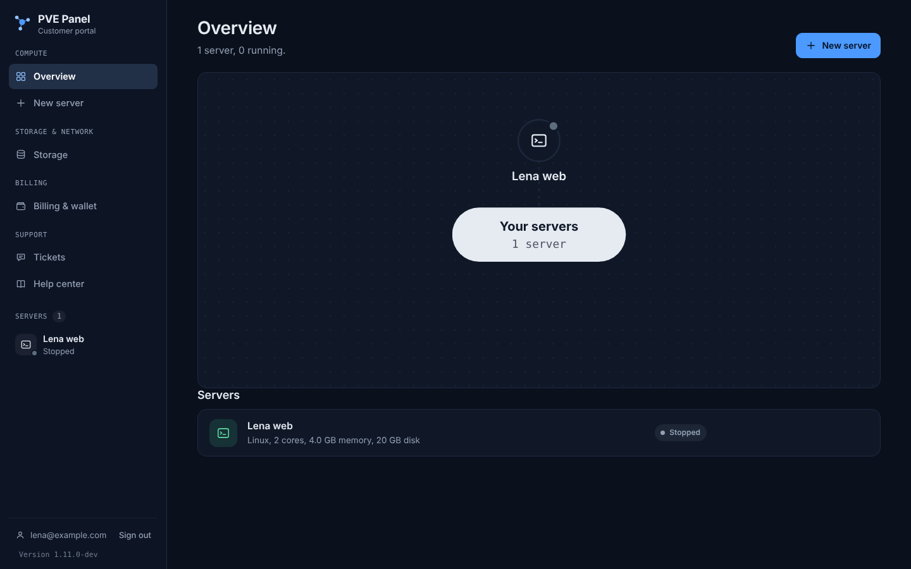 | 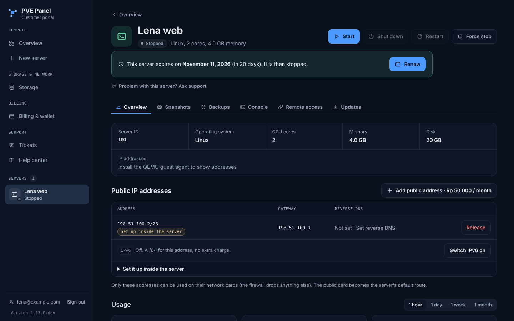 |

| Snapshots and automatic snapshots | Storage (block volumes) |
|---|---|
| 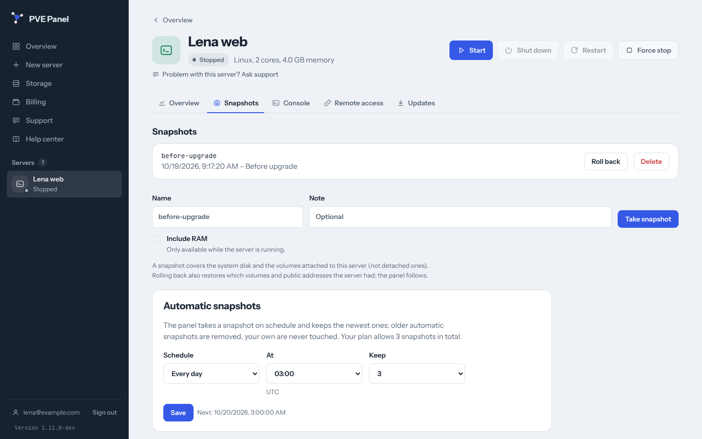 | 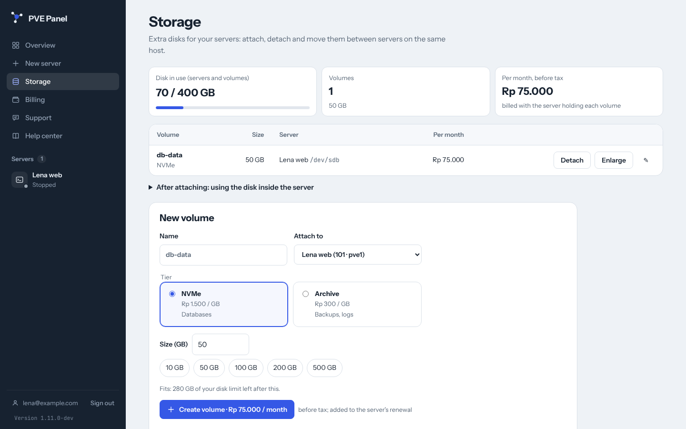 |

| Billing (wallet, invoices) | Provisioning |
|---|---|
| 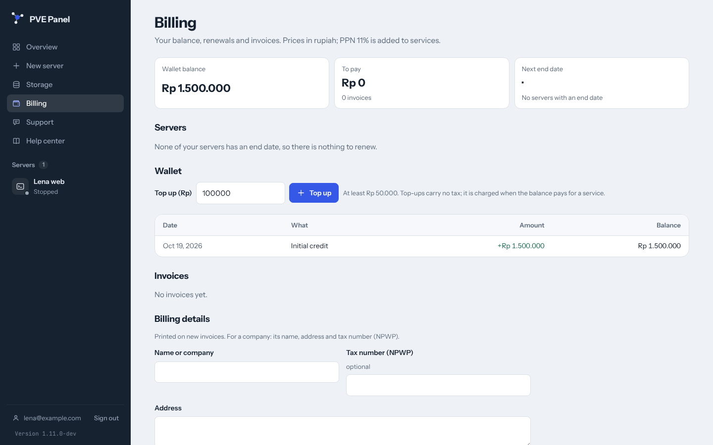 | 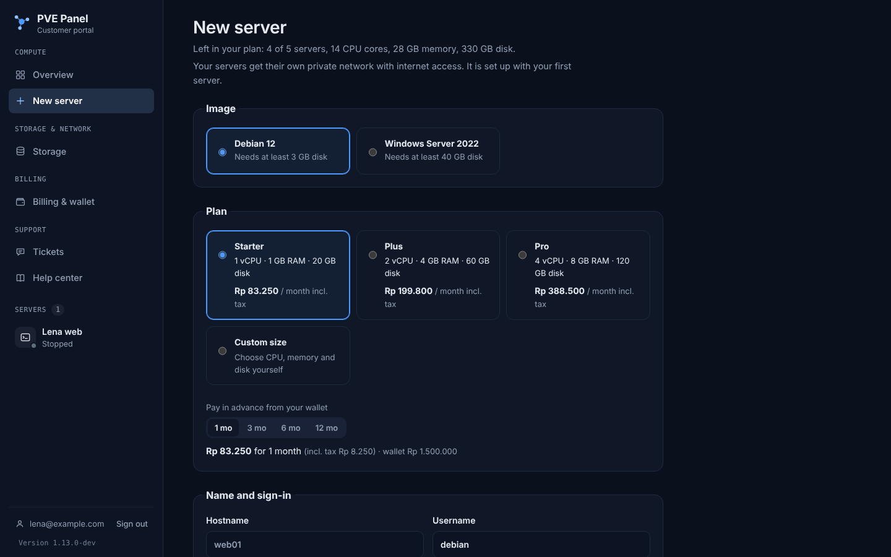 |

### Administrator portal

| Overview dashboard | Clusters and hosts |
|---|---|
| 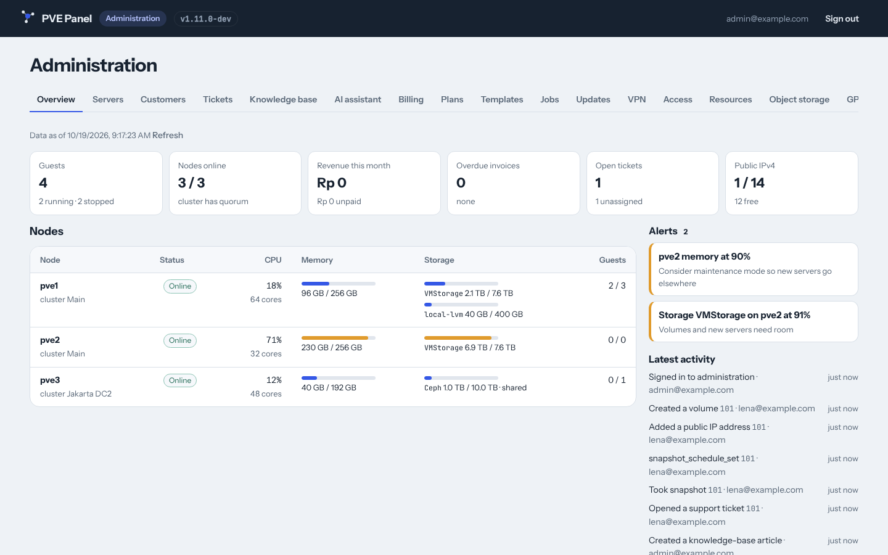 | 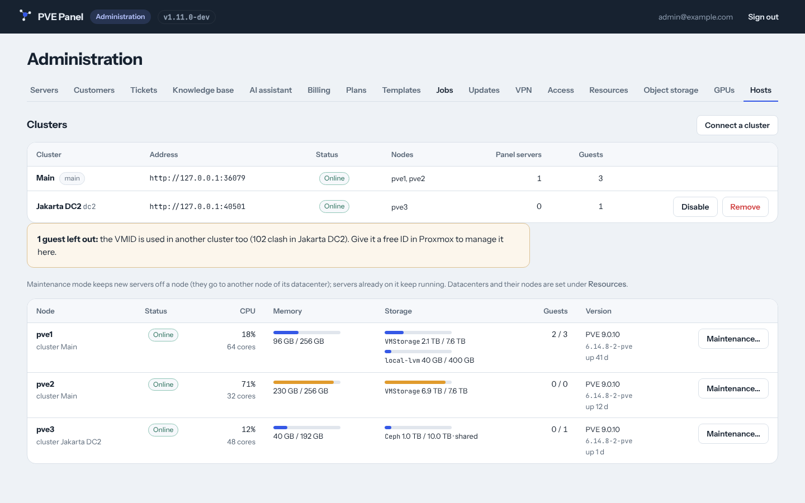 |

| Fleet updates and rollouts | Plans |
|---|---|
| 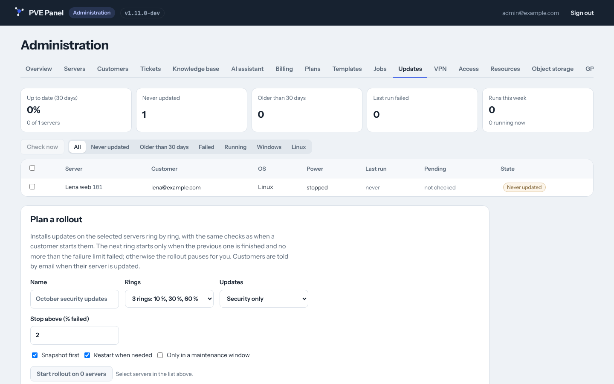 | 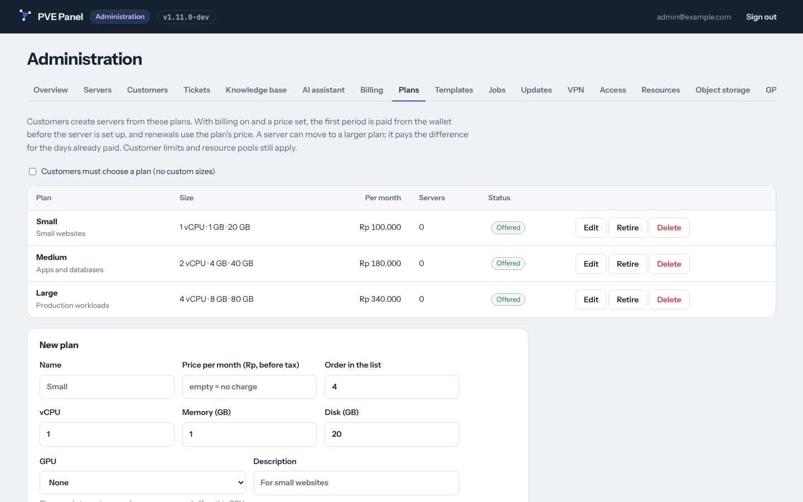 |

| Public IPs (IPAM) | Version & updates |
|---|---|
| 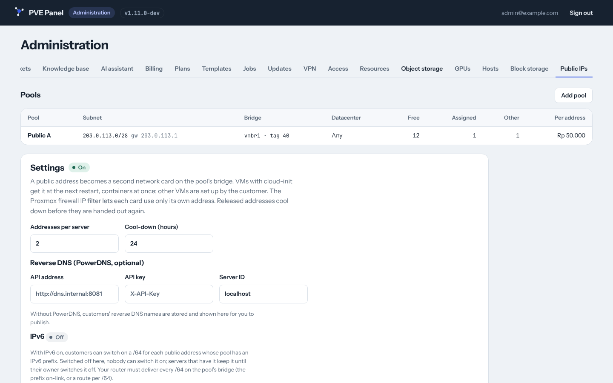 | 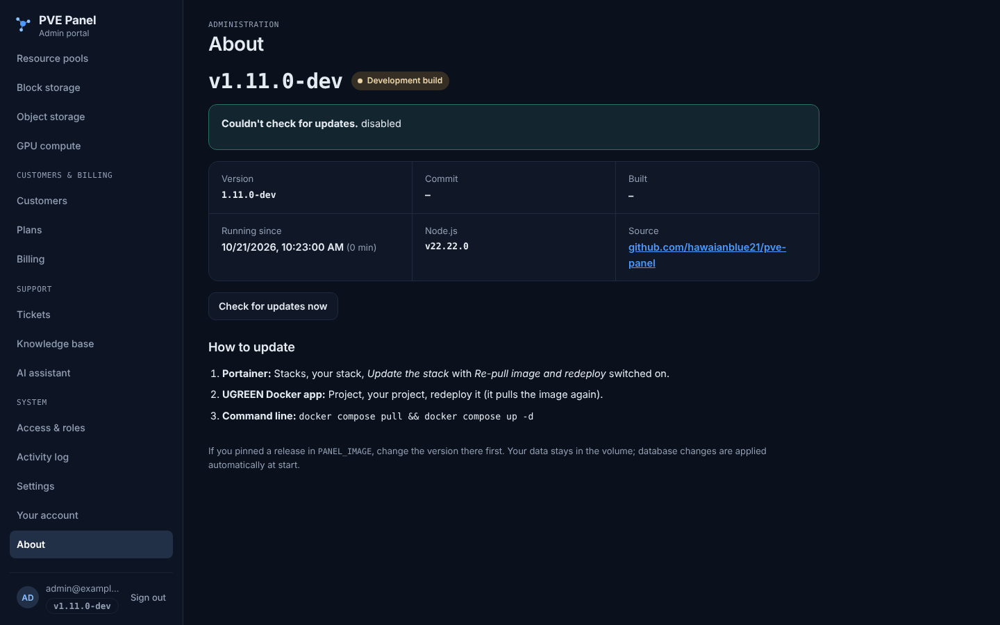 |

### Sign-in

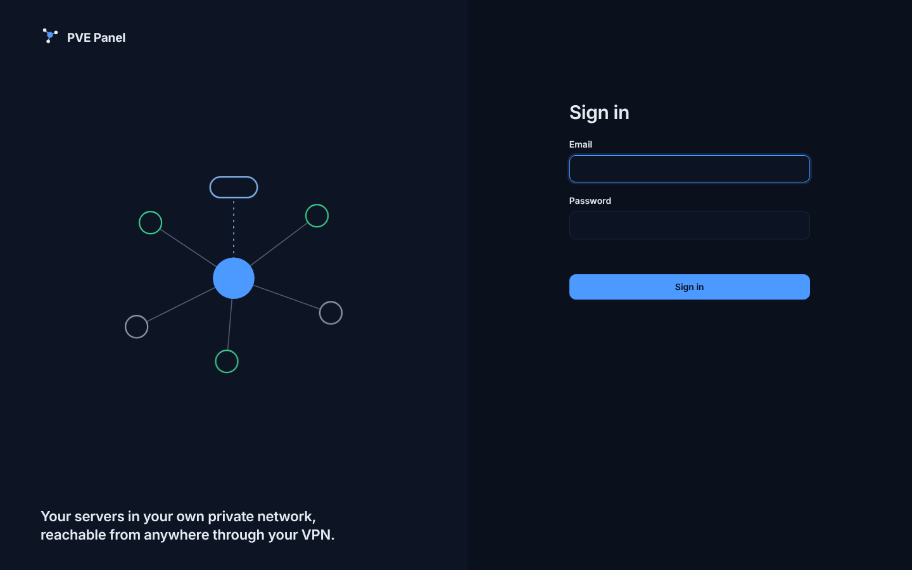

---

## 🏗️ Architecture

PVE Panel deliberately separates the customer-facing application from Proxmox VE.

```text
Customer Browser
      │
      │ HTTPS
      ▼
┌───────────────┐
│ Customer UI   │
│ Port 3000     │
└───────┬───────┘
        │
        ▼
┌───────────────────────────────┐
│           PVE Panel           │
│                               │
│ Authentication                │
│ Ownership checks              │
│ Provisioning jobs             │
│ Snapshot / power operations   │
│ Console proxy                 │
│ Audit logging                 │
│ SDN / VPN management          │
└───────────────┬───────────────┘
                │
                │ API token
                ▼
        ┌───────────────┐
        │ Proxmox VE    │
        └───────────────┘
```

Every server-specific request is checked against the internal ownership database before PVE Panel contacts Proxmox.

A resource that does not belong to the signed-in customer is returned as **404**, just like a resource that does not exist.

---

## 🚀 Quick Start

### Requirements

- Proxmox VE 8 or 9
- Node.js **22.13+** for a native installation
- or Docker / Docker Compose (also Portainer or a NAS Docker app)
- A dedicated Proxmox API user/token
- Optional: Proxmox SDN for isolated customer networks
- Optional: QEMU Guest Agent for richer VM integration

---

## 1. Prepare Proxmox VE

Create a dedicated service account and a restricted role:

```bash
pveum user add panel@pve --comment "PVE Panel"

# Proxmox VE 9
pveum role add PanelCustomer --privs \
"VM.Audit VM.PowerMgmt VM.Console VM.Snapshot VM.Snapshot.Rollback VM.GuestAgent.Audit"

# On PVE 8 use VM.Monitor instead of VM.GuestAgent.Audit.

pveum pool add customers
pveum acl modify /pool/customers --users panel@pve --roles PanelCustomer

# Token inherits the user's permissions.
pveum user token add panel@pve panel --privsep 0
```

Store the generated token secret securely.

Add customer-managed systems to the dedicated pool:

```bash
pveum pool modify customers --vms 101,102
```

Systems outside the configured customer pool remain outside the panel's effective permission scope.

### Additional permissions for self-service provisioning

Only add these permissions when customers should be allowed to create servers:

```bash
pveum role modify PanelCustomer --append 1 \
  --privs "VM.Allocate VM.Clone VM.Config.CPU VM.Config.Memory VM.Config.Disk VM.Config.Cloudinit VM.Config.Options VM.Config.Network Datastore.AllocateSpace Datastore.Audit"

pveum role modify PanelCustomer --append 1 \
  --privs "VM.GuestAgent.Unrestricted"

pveum pool add templates
pveum pool modify templates --vms 9000,9001
pveum acl modify /pool/templates --users panel@pve --roles PanelCustomer

pveum acl modify /storage/VMStorage \
  --users panel@pve --roles PanelCustomer
```

Newly provisioned servers are automatically added to the pool defined by `PVE_POOL`.

---

## 2. Configure PVE Panel

```bash
git clone https://github.com/hawaianblue21/pve-panel.git
cd pve-panel

npm install
cp example.env .env
```

Configure at minimum:

```env
PVE_URL=https://pve.example.com:8006
PVE_TOKEN_ID=panel@pve!panel
PVE_TOKEN_SECRET=your-token-secret
JWT_SECRET=replace-with-a-long-random-secret
```

Create the first administrator:

```bash
npm run user:create -- admin@example.com 'a-long-password' --admin
```

Start the application:

```bash
npm start
```

Development mode:

```bash
npm run dev
```

Default endpoints:

| Interface | Address | Exposure |
|---|---|---|
| Customer portal | `http://host:3000` | Customer-facing |
| Admin portal | `http://127.0.0.1:3001` | Localhost only by default |

For local HTTP testing, set:

```env
COOKIE_SECURE=false
```

> ⚠️ Set `COOKIE_SECURE=true` again for production and serve the customer portal over HTTPS.

---

## 🐳 Deployment

### Docker Compose

```bash
cp example.env .env
docker compose up -d --build
```

Create the first administrator inside the container:

```bash
docker compose exec panel \
  npm run user:create -- admin@example.com 'a-long-password' --admin
```

Or, without a terminal, let the panel create it on first start:

```env
INITIAL_ADMIN_EMAIL=admin@example.com
INITIAL_ADMIN_PASSWORD=replace-me
```

Remove `INITIAL_ADMIN_PASSWORD` after the initial account has been created.

### Prebuilt image

Published container image:

```text
ghcr.io/hawaianblue21/pve-panel
```

The GitHub workflow builds `amd64` and `arm64` images from `main` and release tags, with an SBOM and signed build provenance.

For a server or NAS deployment, use one of:

| File | For |
|---|---|
| `deploy/docker-compose.yml` | Docker Compose, UGREEN Docker app (reads `.env`) |
| `deploy/docker-compose.portainer.yml` | Portainer stacks (reads the stack's variables) |

The image defaults to `ghcr.io/hawaianblue21/pve-panel:latest`. To pin a release:

```env
PANEL_IMAGE=ghcr.io/hawaianblue21/pve-panel:1.1
```

Then deploy:

```bash
docker compose up -d
```

### Portainer

Paste `deploy/docker-compose.portainer.yml` into **Stacks → Add stack → Web editor** and enter the settings under **Environment variables** (or load your `.env`).

> Portainer saves stack variables to `stack.env`. The Portainer file passes them into the container with `env_file: stack.env`; with `env_file: .env` the container would start without settings.

### HTTPS with Caddy

The repository includes a `Caddyfile`.

Set:

```env
PANEL_DOMAIN=panel.example.com
PANEL_PUBLIC_URL=https://panel.example.com
COOKIE_SECURE=true
```

Then start the HTTPS profile:

```bash
docker compose --profile https up -d --build
```

Caddy handles certificate issuance and WebSocket proxying for the browser console.

### UGREEN NAS / UGOS Pro

PVE Panel can also run as a Docker project on compatible UGREEN NAS systems.

A typical deployment directory is:

```text
/volume1/docker/pve-panel
```

For a prebuilt-image deployment, place the deployment `docker-compose.yml` and `.env` in the directory and create a Docker Project in UGOS (**Docker → Project → Create**).

Add the NAS's IP to the Proxmox `management` IPSet so the panel can reach the Proxmox API.

---

## 📦 Versions & updates

The running version is stamped into the image by the release workflow — nothing to edit by hand.

- **Admin portal:** version badge in the top bar (a dot = update available) and an **About** tab with version, commit, build date, uptime and update instructions
- **Customer portal:** the version number in the sidebar and on the Account page (`SHOW_VERSION_TO_CUSTOMERS=false` hides it)
- **Update check:** asks GitHub for the latest release, at most every 6 hours (`UPDATE_CHECK=false` turns it off)

### Publishing a release

```bash
npm version patch      # 1.1.0 -> 1.1.1  (fixes)
npm version minor      # 1.1.1 -> 1.2.0  (new features)
npm version major      # 1.2.0 -> 2.0.0  (breaking changes)
git push --follow-tags
```

`npm version` raises the version in `package.json`, commits it and creates the tag. The workflow then:

1. builds the image as `1.2.0`, `1.2`, `1` and moves `latest` to it
2. creates a **GitHub Release** with generated release notes
3. refuses to build if the tag and `package.json` disagree

Pushes to `main` without a tag build development versions such as `1.2.0-dev.a1b2c3d` and publish them as `edge` — they never replace `latest`.

| Image tag | Contains | Use it for |
|---|---|---|
| `latest` | the newest release | normal deployments |
| `1.4` / `1` | newest release of that line | updates within a version line only |
| `1.4.0` | exactly that release | fully pinned deployments |
| `edge` | the newest development build from `main` | testing only |

### Updating a deployment

| Deployment | Update |
|---|---|
| Portainer | Stacks → your stack → **Update the stack** with *Re-pull image and redeploy* |
| UGREEN Docker app | Project → your project → redeploy |
| Command line | `docker compose pull && docker compose up -d` |

Data stays in the volume; database changes are applied automatically at start.

---

## 👤 Server ownership

PVE Panel does not rely only on Proxmox permissions to determine which systems a customer can see.

Each assigned resource is tracked in the internal ownership database.

Before any per-server operation is sent to Proxmox, PVE Panel validates ownership.

```text
Request
  │
  ▼
Authenticated customer
  │
  ▼
Ownership lookup
  │
  ├── not owner ──► 404
  │
  └── owner
        │
        ▼
   Proxmox API
```

This applies to:

- status
- power operations
- snapshots
- usage data
- consoles
- deletion
- remote-access operations

---

## 🌐 Customer network isolation

PVE Panel can automatically create one private Proxmox SDN network for each customer.

Enable it with:

```env
CUSTOMER_NETWORKS=true
```

Example:

```text
Customer 1
   │
   └── cu0001 ── 10.100.1.0/24 ──┐
                                   │
Customer 2                         ├── NAT ──► Internet
   │                               │
   └── cu0002 ── 10.100.2.0/24 ──┘
```

Each network receives:

- its own SDN VNet, with the customer's name as alias (e.g. `lena (example.com)`)
- dedicated `/24` subnet
- gateway
- DHCP
- NAT
- Proxmox firewall rules
- IP filtering
- MAC filtering
- inter-customer isolation

By default, customer workloads can access the public internet while private/internal networks are blocked.

Typical blocked ranges include:

```text
10.0.0.0/8
172.16.0.0/12
192.168.0.0/16
100.64.0.0/10
169.254.0.0/16
```

This prevents customer workloads from using the Proxmox host as a route into internal networks.

### Required SDN permissions

```bash
pveum role add PanelNetwork --privs "SDN.Allocate SDN.Audit SDN.Use"
pveum acl modify /sdn --users panel@pve --roles PanelNetwork
```

Install `dnsmasq` on the Proxmox host:

```bash
apt install dnsmasq
systemctl disable --now dnsmasq
```

### Host firewall

Set these up **before** enabling the datacenter firewall:

```bash
# Keep the Proxmox UI/API reachable for your admin network and the panel host
pvesh create /cluster/firewall/ipset --name management
pvesh create /cluster/firewall/ipset/management --cidr 192.168.50.0/24

# DHCP for customer networks — no source filter (requests come from 0.0.0.0)
pvesh create /cluster/firewall/rules --type in --action ACCEPT --proto udp --dport 67 --enable 1

# Ping to the host (blocked by default)
pvesh create /cluster/firewall/rules --type in --action ACCEPT --macro Ping --enable 1
```

The panel creates and maintains the necessary customer SDN objects when provisioning is enabled.

> **Important**
>
> Customer isolation depends on the Proxmox datacenter firewall being enabled. Validate management access before enabling it remotely. Locked out? From the console: `pvesh set /cluster/firewall/options --enable 0`.

---

## 🔑 API tokens

Scripts and integrations use the same API as the portals with `Authorization: Bearer <token>`. Tokens are created on
the account page (customer portal) or under **Your account** (admin portal); the token is shown once, only its
SHA-256 is stored, and each token shows when and from where it was last used.

```bash
curl -H "Authorization: Bearer pvc_12_…" https://portal.example.com/api/vms
curl -X POST -H "Authorization: Bearer pvc_12_…" https://portal.example.com/api/vms/101/power/reboot
```

| | Customer token (`pvc_…`) | Admin token (`pva_…`) |
|---|---|---|
| Reads | servers, graphs, snapshots, storage, IPs, billing, tickets, help center | what the role allows |
| Changes | only the chosen permissions: power, servers, storage, network, billing, support | what the role allows, unless read-only |
| Never | sign-in, account security, console, S3 keys, AI assistant, tokens | tokens, administrators and roles, sign-in |
| Valid | 7, 30, 90 or 365 days, or without end | same |

Every request re-checks the account: deleting a user, or taking away admin rights, stops their tokens at once.
Actions done with a token are marked with its name in the activity log. Owners see and revoke every administrator's
tokens.

---

## 🔐 Authentication

### Local authentication

PVE Panel supports traditional username/password authentication with secure server-side controls and rate limiting. Password sign-in can be switched off per portal once SSO works.

### Two-factor authentication

TOTP-based two-factor authentication is built in.

Compatible apps include:

- 1Password
- Microsoft Authenticator
- Google Authenticator
- Authy
- other RFC 6238-compatible authenticators

Features include:

- QR-code enrollment
- recovery codes
- forced 2FA per user
- administrator reset
- one-time use protection
- encrypted TOTP secrets

Locked out yourself? `npm run user:reset-2fa -- admin@example.com`

### Passkeys

Sign in with **fingerprint, face, device PIN or a security key** — no email, password or code. Phishing-resistant (WebAuthn/FIDO2).

- add, rename and remove passkeys under **Account**; synced passkeys and security keys work
- a passkey sign-in counts as two-factor (it satisfies required 2FA)
- needs a domain name over https (or `localhost`), not a bare IP address
- administrators can remove a user's passkeys (lost device)

Details: [Passkeys](https://hawaianblue21.github.io/pve-panel/docs/security/passkeys).

### OpenID Connect / SSO

PVE Panel supports OpenID Connect for both the customer and administrator portals.

Designed for standards-compliant providers such as:

- Microsoft Entra ID
- Keycloak
- Authentik
- Google Workspace
- Okta

The implementation is tested against a certified OpenID provider and uses:

- Authorization Code Flow
- PKCE (`S256`)
- `state`
- `nonce`
- discovery metadata
- ID-token validation (via the OpenID-certified `openid-client`)
- Pushed Authorization Requests (PAR) when the provider supports them
- optional verified-domain restrictions
- issuer + `sub` account binding

Example configuration:

```env
OIDC_ENABLED=true
OIDC_ISSUER=https://id.example.com/realms/example
OIDC_CLIENT_ID=pve-panel
OIDC_CLIENT_SECRET=replace-me

PANEL_PUBLIC_URL=https://panel.example.com
ADMIN_PUBLIC_URL=http://localhost:3001
```

Callback URLs:

```text
https://panel.example.com/api/auth/oidc/callback
http://localhost:3001/api/auth/oidc/callback
```

Only the panel needs to reach the provider (outbound HTTPS); the provider never connects to the panel.

> **Microsoft Entra ID** doesn't send `email_verified`: set `OIDC_REQUIRE_VERIFIED_EMAIL=false` together with `OIDC_ALLOWED_DOMAINS`. Provider notes are in the [documentation](https://hawaianblue21.github.io/pve-panel/docs/security/single-sign-on).

Once SSO is validated, local password login can optionally be disabled independently for each portal.

### Google, Microsoft and GitHub

Next to the generic OIDC provider above, the panel owner can switch on **Google**, **Microsoft** (Entra ID / Microsoft 365)
and **GitHub** in the **admin portal → Settings → Single sign-on**: create an app at the provider, enter the redirect
address shown there (`https://<panel>/api/auth/sso/<provider>/callback`), paste the client ID and secret (stored encrypted,
never shown again) and choose the portals. `PANEL_PUBLIC_URL` (and `ADMIN_PUBLIC_URL` for the admin portal) must be set.

| | Google | Microsoft | GitHub |
|---|---|---|---|
| Protocol | OpenID Connect, PKCE, nonce | OpenID Connect, PKCE, nonce | OAuth 2.0, PKCE, state |
| Identity kept | issuer + subject | issuer + subject | GitHub user ID |
| Email trusted for sign-up when | `email_verified` | `xms_edov`, or the tenant is your own organisation | primary email is verified |

Rules:

- **No take-over by email.** An existing panel account is never linked just because the email matches. The user signs in as
  usual and links the provider under **Account → Sign-in methods**; linking needs a sign-in from the last 15 minutes.
- **Sign-up** (new customer accounts) is off by default, per provider, and only with an email the provider has verified;
  optionally limited to email domains. Administrators are never created this way and must link the provider first.
- The panel's own 2FA still applies after a provider sign-in, unless the provider reports multi-factor (`amr`).
- The last way to sign in can't be unlinked. Every link, unlink, sign-up and refusal is in the activity log.

---

## 🎧 Support tickets & knowledge base

Customers open tickets under **Support** (or *Problem with this server? Ask support* on a server page). While they type
the subject, matching help-center articles are suggested. Agents answer in the admin portal under **Tickets**:

| | |
|---|---|
| Status | *open* (support's turn) → *waiting* (after an answer: the customer's turn, shown as a badge in the menu) → *solved* / *closed*; a customer reply opens it again |
| Queues | **L1** first response; **L2** network and storage (or urgent); **L3** security. Changeable per ticket |
| Next to each ticket | the customer's servers and their state, the last account activity, matching articles (one click adds a link to the reply) |
| Notes | internal notes are never shown to the customer and never emailed |
| Email | the customer gets every answer by email (when email is set up), with a link straight to the ticket |

The **knowledge base** (admin portal → **Knowledge base**) holds Markdown articles with a draft / published state and a
visibility: *everyone* (also before sign-in, via `/api/kb`), *signed-in customers*, or *agents only*. A solved ticket can
become a draft article in one click (problem + answer; remove personal details before publishing). Help-center searches
that found nothing are listed, most frequent first, with *Write article*.

Permissions: `support.read`, `support.write`, `kb.write`. The built-in **Support agent** role has them plus read access;
**Operator** can answer and write articles; **Support (read-only)** only reads.

### AI assistant

Customers can chat with an assistant (menu **AI assistant**) once the owner sets it up in **Settings → AI assistant**:

| Provider | Settings |
|---|---|
| **Claude** (Anthropic Messages API) | API key and model (default `claude-sonnet-5-5`); address empty = `https://api.anthropic.com` |
| **OpenAI-compatible** | Address up to `/v1` (OpenAI, Azure-style gateways, or a model in your own network through vLLM, Ollama, LM Studio; http is allowed there), model, optional key |

What it can do, with tools that always run as the signed-in customer:

- search and read the **help center** (never agents-only articles) and name the articles it used as sources
- read the customer's **own servers** (state, size, usage, expiry) and **tickets**
- **propose a ticket** (subject, summary, category, priority, server): the customer sees a *Create ticket* button; the ticket
  gets the whole conversation attached and is routed like any other

What it can't do: start, stop, change, delete or order anything, or see other customers. Limits: questions per customer
per day (default 40), tool rounds per answer (5), message length (2,000 characters), answer length. If the provider
fails, customers get a friendly message and the error is in the activity log.

Administrators (`support.read`) see the usage (conversations, questions, handovers, ratings, tokens) and every
conversation including the tools the assistant called, in **AI assistant**. Questions and answers are sent to the
provider configured here: choose it to fit your privacy requirements, e.g. a local model.

### Optional: Zammad

Tickets always work in the panel. To also use a [Zammad](https://zammad.org) helpdesk (email, WhatsApp, phone, SLAs),
fill in **Settings → Helpdesk: Zammad**: the address, an API token of an agent, and the Zammad group for each queue.

- **Panel → Zammad**: new tickets (customer matched by email, created if needed), customer messages (*on behalf of* the
  customer), agent replies and notes from the panel, and status / priority / queue changes.
- **Zammad → panel**: in Zammad, add a **webhook** to the endpoint shown in Settings with the shown **HMAC SHA1 signature
  token**, and a **trigger** that calls it when a ticket is created or updated. Articles written in Zammad come back to
  the panel ticket (once each), closed tickets close in the panel. Calls with a wrong signature are refused and logged.
- If Zammad can't be reached, the panel keeps the ticket, shows the error on it, and retries every two minutes (or now,
  with *Send waiting items*).

---

## ✉️ Email & invitations

Email is configured in the **admin portal → Settings**, not in `.env`:

- SMTP server, port and encryption (**TLS**, **STARTTLS** or none for an internal relay)
- username and password — the password is stored **encrypted** and never shown again
- sender name and address
- the panel address used in links
- a **Send test email** button to verify everything end to end

Once email works, **Add a customer** offers **Send an invitation email**. Instead of a password chosen by the admin, the user receives:

- the panel address and their sign-in email
- a personal link to **set their own password**
- a note when 2FA is required or single sign-on is used

```text
Admin adds user ──► Invitation email ──► User opens link ──► Sets password ──► Signs in
                                          (single-use, 3 days)
```

Invitation links:

- work **once** and expire after **3 days**
- are stored only as a SHA-256 hash
- carry the token after `#`, so it never reaches server logs or `Referer` headers
- are replaced by **Resend invitation** (the old link stops working)

The customer list shows *Invitation pending* or *Invitation expired* until the user has set a password.

> Changing `JWT_SECRET` makes the stored SMTP password unreadable — enter it again in Settings afterwards.

---

## 🪟🐧 Operating system updates

### Windows

Customers install the latest Windows updates from the server page — **Updates** tab:

- security and critical updates (default), or all quality updates — never feature upgrades or previews
- optional **snapshot first**, so a bad update can be rolled back
- restarts automatically when needed (or waits for *Restart now*) and continues until Windows is up to date
- live progress and a list of installed updates; failures explained in plain words

Runs through the QEMU guest agent and Windows' own update API; respects WSUS/group policy. Switch it off under **Settings → Operating system updates**.

Details: [Windows updates](https://hawaianblue21.github.io/pve-panel/docs/features/windows-updates).

### Linux (apt / dnf)

The same tab on Linux virtual machines installs package updates from the distribution's own repositories:

- **Security updates only** (default; packages from a `*-security` archive on Debian/Ubuntu, `dnf --security` on RHEL,
  Rocky, Alma, Fedora) or **all package updates**
- optional **snapshot first**; at least 1 GB free on `/` is checked before starting
- never: release upgrades (e.g. 24.04 → 26.04), removing packages, held (`apt-mark hold`) or version-locked packages;
  changed configuration files are kept (`--force-confold`)
- after a new kernel or system libraries: **restart automatically** (optional) or a *Restart now* reminder until the server
  has been restarted

How it works: the panel copies `src/guest/linux-update.sh` into the server through the QEMU guest agent and starts it
detached (`systemd-run`, or `setsid` without systemd), then reads its progress file
(`/var/lib/pvepanel/update-status.json`). Containers (LXC) have no guest agent and are not offered. Switch Linux updates
off separately under **Settings → Operating system updates**.

---

### Fleet view and rollouts (admin portal)

**Updates** shows every customer server with its OS and last update run: up to date, never updated, older than 30 days,
failed, running. Administrators with `updates.write` (Operator role) select servers and start a **rollout**:

```text
Ring 1 (10 %) ──► all finished, ≤ limit failed? ──► Ring 2 (30 %) ──► … ──► Done
                         └── more failed ──► Paused: check the servers, then Resume (next ring) or Cancel
```

Each run is an ordinary update run (security or all updates, snapshot first, restart when needed) with the same
checks as when a customer starts it; servers that can't run (stopped, no guest agent, updates switched off, expired)
are skipped with the reason. Customers get an email when their server is updated.

- **Maintenance window** (optional): days of the week and hours in the panel's time zone (`PANEL_TIMEZONE`, e.g.
  Sat and Sun 01:00–05:00; an end before the start runs past midnight). Outside it no new run starts and the rollout
  shows *Waiting for the maintenance window*; runs already started finish.
- **Check now**: counts pending updates inside the selected running servers (apt / dnf simulation, Windows Update
  search; nothing is downloaded or installed), four at a time, and shows *N pending (M security)* with the time of the
  check, so you see what a rollout would bring. Windows searches can take minutes.

**Jobs** lists background work: servers being set up, reinstalled or deleted (and failed ones), update runs, rollouts,
and finished work of the last 7 days. Failed work can be **retried** where the panel has everything it needs:

| Failed job | Retry | Permission |
|---|---|---|
| Deleting a server | deletes again (the server must be shut down) | `servers.delete` |
| Update run (the server's latest) | starts the run again with the same options | `updates.write` |
| Automatic snapshot (the server's latest) | takes the snapshot now | `servers.manage` |
| Creating or reinstalling a server | not possible: it needs the customer's sign-in details, so the customer reinstalls or deletes it | |

---

## ⏳ Server expiry

Opt-in end dates for **single customers or servers** — trials, test servers, courses:

```text
Reminders (7 / 1 days) ──► Expired: stopped ──► Grace period (14 days) ──► Deleted
                                    └─ one-click extension (admin, or customer once) ─┘
```

- per customer: *N days after creation* or *on a fixed date*; per server: set, extend or remove a date
- only **customer-created** servers are deleted automatically — servers you assigned are only stopped
- nothing is deleted without an email warning; deletions can be paused globally
- reminders, notices and a daily admin summary by email

Details: [Server expiry](https://hawaianblue21.github.io/pve-panel/docs/administration/expiry).

---

## 📦 Plans

Plans are fixed sizes (vCPU, memory, disk, optionally a GPU) with a monthly price, managed in the admin portal under
**Plans** (owner or *Finance*). Customers then pick a plan in **New server**; with *Customers must choose a plan* switched
on, custom sizes are gone.

| | Without billing | With billing and a price |
|---|---|---|
| New server | the plan sets the size | 1, 3, 6 or 12 months are paid from the wallet first (discounts and PPN as for renewals); not enough balance: nothing is created |
| Setup fails | n/a | the order is refunded to the wallet automatically |
| Renewal | n/a | at the plan's current price (a fixed server price set by an administrator wins) |
| Larger plan | free | the difference in monthly price for the days already paid, plus tax |

- A server on a plan is resized only by moving to a larger plan (same GPU; disks only grow).
- A plan's size can't change while servers use it; retire it and add a new one. A price change applies from each server's
  next invoice; unpaid renewals at the old size or price are replaced.
- GPU plans are shown only to customers whose resource pool offers that GPU. Customer limits and pools still apply.

---

## 💳 Billing & payments (Xendit, Midtrans)

Off by default. The owner switches it on in **Settings → Billing**; customers then see **Billing** in the menu and a
**Renew** button on servers with an end date. Billing builds on [server expiry](#-server-expiry): a paid renewal moves
the end date (and starts an expired server again).

```text
Customer ── renew 1/3/6/12 months or top up ──► Invoice (PPN) ──► pay:
   wallet ─────────────────────────────────────────────────────► paid at once
   Xendit / Midtrans ─► payment page ─► webhook ─► status API check ─► paid
   bank transfer ─► customer reports reference ─► admin confirms ───► paid
Paid renewal ──► end date + 30 days per month · paid top-up ──► wallet balance
Auto-renew ──► N days before the end: one month from the wallet (email if the balance is short)
```

- **Prices** come from a rate card (per vCPU, GB RAM, GB disk, with a minimum; rounded up to Rp 1.000) or a fixed
  price per server; discounts for 3, 6 and 12 months; tax name and rate (default PPN 11 %) are settings.
- **Top-ups** are not taxed: tax is charged on the service the balance pays for.
- **Invoices** are numbered `PREFIX-YYYYMM-0001`, carry seller and customer details (incl. NPWP) and print as PDF.
- **Gateways** are never trusted on their notification alone. Xendit: the `x-callback-token` header must match;
  Midtrans: the SHA-512 `signature_key` must match. Then the panel asks the gateway's API for the status and the paid
  amount; a smaller amount is not accepted. A payment that arrives twice (two payment pages) goes to the wallet.
- API keys are stored encrypted and never shown again.

| Gateway | Panel setting | In the gateway dashboard |
|---|---|---|
| Xendit (Invoice API) | Secret API key (Money-in write), callback verification token | Webhook *Invoices paid* → `https://portal.example.com/api/billing/webhooks/xendit` |
| Midtrans (Snap) | Server key, sandbox on/off | Notification URL → `https://portal.example.com/api/billing/webhooks/midtrans` |

Set `PANEL_PUBLIC_URL` (the customer portal address): Settings shows the webhook addresses from it, and customers return
to their invoice there after paying (without it, the address the browser used). Auto-renew runs every hour (`AUTORENEW_INTERVAL_SECONDS`).

---

## 🪟 Windows templates

Windows systems can be deployed without cloud-init.

The repository includes:

```text
docs/windows/unattend.xml
```

Recommended template workflow:

1. Install Windows.
2. Install VirtIO drivers.
3. Install the QEMU Guest Agent.
4. Enable the QEMU Guest Agent in Proxmox.
5. Configure the desired base applications and settings.
6. Ensure the network adapter uses DHCP.
7. Copy and customize `docs/windows/unattend.xml`.
8. Run Sysprep.
9. Shut down the VM.
10. Convert it to a Proxmox template without booting it again.

Example:

```cmd
copy unattend.xml C:\Windows\System32\Sysprep\unattend.xml

C:\Windows\System32\Sysprep\sysprep.exe ^
  /generalize ^
  /oobe ^
  /shutdown ^
  /unattend:C:\Windows\System32\Sysprep\unattend.xml
```

During provisioning PVE Panel can:

- wait for Windows setup to complete
- set the final Administrator password
- verify the password
- rename the computer
- force DHCP on network adapters
- validate that an address was received
- reboot the VM
- report provisioning failures to the customer

---

## 🐧 Linux templates

Linux provisioning uses cloud-init.

A template should contain:

- a cloud-init-compatible image
- a cloud-init drive
- DHCP networking
- optionally `qemu-guest-agent`

PVE Panel applies:

- hostname
- username/password
- SSH keys
- CPU
- memory
- network configuration
- disk expansion

---

## 🔌 Remote access

PVE Panel supports multiple ways to reach customer systems without exposing Proxmox itself.

### Browser console

Customers can launch one-time console sessions directly from the panel.

Console sessions are:

- bound to the requesting user
- single-use
- short-lived
- proxied through PVE Panel

### WireGuard VPN

An optional central WireGuard gateway can provide remote access into each customer's private network.

```text
Laptop / Phone
      │
      │ WireGuard
      ▼
Public IP : UDP 51820
      │
      ▼
┌──────────────────┐
│ WireGuard Gateway│
└─────────┬────────┘
          │
          ├── Customer 1 VPN clients → Customer 1 VNet only
          └── Customer 2 VPN clients → Customer 2 VNet only
```

Customers can:

- add VPN devices
- download configuration files
- scan QR codes
- see connection state
- remove devices

Private keys are shown once and are not retained by the panel.

The gateway is prepared once with `docs/vpn/setup-gateway.sh` — see the [documentation](https://hawaianblue21.github.io/pve-panel/docs/networking/wireguard-vpn) for the routing and port-forward steps.

### Tailscale

When enabled, customers can connect individual servers to their own Tailscale account.

Supported modes:

- **Single server** — expose only that server through the customer's tailnet
- **Private-network gateway** — advertise the customer's private subnet through a Linux VM

PVE Panel installs and configures Tailscale through the QEMU Guest Agent.

The customer's Tailscale account itself is never managed by the panel.

---

## 🛡️ Security model

PVE Panel was designed so that giving customers self-service access does **not** mean giving them Proxmox access.

Key controls include:

- Dedicated Proxmox service account
- Restrictive custom Proxmox roles
- Resource pool scoping
- Application-level ownership validation
- Separate customer and admin HTTP servers
- Separate customer/admin sessions
- Admin interface bound to localhost by default
- `httpOnly` session cookies
- `SameSite=Strict`
- Rate limiting
- Short-lived, user-bound console tickets
- User-bound task tracking
- Audit logging
- Optional TOTP 2FA
- Passkeys (WebAuthn) with required user verification
- OIDC with PKCE and token validation
- Customer-specific SDN isolation
- VM firewall enforcement (incoming and outgoing)
- IP and MAC filtering
- Restricted VPN routing
- Proxmox API token kept server-side
- No secrets in the container image

### TLS to Proxmox

For production deployments, use a trusted Proxmox certificate or provide the Proxmox CA:

```env
PVE_CA_FILE=/app/certs/pve-root-ca.pem
```

Avoid:

```env
PVE_VERIFY_TLS=false
```

outside development environments.

---

## 🔒 Admin interface

The administrator portal listens on localhost by default:

```text
127.0.0.1:3001
```

Access it securely through SSH:

```bash
ssh -L 3001:127.0.0.1:3001 you@panel-host
```

Then browse to:

```text
http://localhost:3001
```

If the admin interface is exposed on another interface, protect it with network-level access controls.

---

## 🔁 Reverse proxy

The customer portal can be placed behind an existing reverse proxy.

WebSocket upgrades are required for the integrated console.

Example NGINX configuration:

```nginx
server {
    listen 443 ssl http2;
    server_name panel.example.com;

    location / {
        proxy_pass http://127.0.0.1:3000;

        proxy_set_header Host $host;
        proxy_set_header X-Forwarded-For $proxy_add_x_forwarded_for;
        proxy_set_header X-Forwarded-Proto $scheme;

        proxy_http_version 1.1;
        proxy_set_header Upgrade $http_upgrade;
        proxy_set_header Connection "upgrade";
        proxy_read_timeout 1h;
    }
}
```

---

## 📦 Backups

The application database lives in the persistent Docker volume.

Create a consistent backup:

```bash
docker compose exec panel npm run db:backup
```

Copy backups from the container:

```bash
docker compose cp panel:/app/data/backups ./backups
```

---

## 🧰 Useful CLI commands

Create an administrator:

```bash
npm run user:create -- admin@example.com 'a-long-password' --admin
```

Create a customer (optionally requiring 2FA):

```bash
npm run user:create -- customer@example.com 'another-long-password' --require-2fa
```

Assign an existing VM or container:

```bash
npm run vm:assign -- 101 customer@example.com "Web server"
```

Reset 2FA:

```bash
npm run user:reset-2fa -- admin@example.com
```

Backup the database:

```bash
npm run db:backup
```

---

## 🔧 Branding

The panel owner sets the **product name**, a **logo** (SVG, PNG or WebP, up to 512 KB), a **browser tab icon** and a
**support link** (shown under the sign-in form) in the **admin portal → Settings → Branding**. The name set there
overrides `PANEL_NAME`. Images are stored in the branding folder (see below) and checked on upload (SVGs with scripts or
links are refused; all files are served with a script-blocking sandbox policy).

The default product name comes from `.env`:

```env
PANEL_NAME=PVE Panel
```

The configured name is used on:

- sign-in pages
- navigation
- browser titles
- customer portal
- administrator portal
- the authenticator app entry for 2FA
- emails sent by the panel (colors follow the color scheme)

### Color schemes

Five color schemes — **Harbor** (default), **Forest**, **Ember**, **Orchid**, **Graphite** — each with a light and dark variant. Set in **Settings → Appearance** for everyone: admin interface, customer portal, sign-in pages and emails.

Users can also pick their **own** scheme and **light, dark or device** mode under **Account → Appearance** (stored with
their account, so it follows them to other devices). The owner can switch this off; everyone then sees the panel's scheme.


### Own OS icons

Windows and Linux servers are shown with neutral built-in glyphs. To use your own icons, place any of these files in the branding folder:

```text
os-windows.svg   os-linux.svg     (or .png / .webp)
```

The folder is `BRANDING_DIR` (default `data/branding/` next to the database). With Docker, mount it:

```yaml
volumes:
  - ./branding:/app/branding:ro
```

```env
BRANDING_DIR=/app/branding
```

Only these file names are served, with a strict sandbox policy. Make sure you're allowed to use the images you add.

---

## 📂 Project structure

```text
.
├── src/
│   ├── activity.js
│   ├── agent.js
│   ├── ai-providers.js
│   ├── ai.js
│   ├── appearance.js
│   ├── auth.js
│   ├── billing.js
│   ├── bootstrap.js
│   ├── branding.js
│   ├── cleanup.js
│   ├── clock.js
│   ├── clusters.js
│   ├── config.js
│   ├── db.js
│   ├── expiry.js
│   ├── gateways.js
│   ├── gpu.js
│   ├── hosts.js
│   ├── invite.js
│   ├── ipam.js
│   ├── kb.js
│   ├── linuxupdate.js
│   ├── mail.js
│   ├── network.js
│   ├── oidc.js
│   ├── passkeys.js
│   ├── plans.js
│   ├── pools.js
│   ├── provision.js
│   ├── pve.js
│   ├── rbac.js
│   ├── rollouts.js
│   ├── seaweedfs.js
│   ├── secrets.js
│   ├── server.js
│   ├── sigv4.js
│   ├── snapschedule.js
│   ├── sso.js
│   ├── support.js
│   ├── tailscale.js
│   ├── tokens.js
│   ├── totp.js
│   ├── version.js
│   ├── volumes.js
│   ├── vpn.js
│   ├── windows.js
│   ├── winupdate.js
│   ├── zammad.js
│   ├── guest/            # scripts run inside Linux guests (setup, status, updates)
│   └── routes/
│       ├── admin-billing.js
│       ├── admin-clusters.js
│       ├── admin-hosts.js
│       ├── admin-infra.js
│       ├── admin-ipam.js
│       ├── admin-jobs.js
│       ├── admin-plans.js
│       ├── admin-support.js
│       ├── admin-volumes.js
│       ├── admin.js
│       ├── assistant.js
│       ├── billing.js
│       ├── console.js
│       ├── ips.js
│       ├── storage.js
│       ├── support.js
│       ├── tokens.js
│       ├── vms.js
│       ├── volumes.js
│       └── vpn.js
│
├── web/
│   ├── customer/         # customer portal (servers, storage, billing, support, assistant)
│   ├── admin/            # admin portal (overview, hosts, jobs, plans, IPAM, volumes, desk, billing)
│   └── shared/
│
├── docs/
│   ├── screenshots/      # images used in this README
│   ├── design/           # UI/UX design reference
│   ├── windows/
│   │   └── unattend.xml
│   └── vpn/
│       └── setup-gateway.sh
│
├── scripts/
├── test/               # unit, API and browser tests, simulated Proxmox
├── deploy/
│   ├── docker-compose.yml
│   └── docker-compose.portainer.yml
│
├── website/            # documentation website (Docusaurus)
│
├── .github/
│   ├── workflows/docker-publish.yml
│   ├── workflows/docs.yml
│   ├── workflows/test.yml
│   ├── workflows/codeql.yml
│   ├── dependabot.yml
│   └── release.yml
├── Dockerfile
├── docker-compose.yml
├── Caddyfile
├── example.env
└── package.json
```

---

## 🔌 API overview

### Customer API

| Method | Endpoint | Purpose |
|---|---|---|
| `GET` | `/api/vms` | List owned servers |
| `GET` | `/api/vms/:vmid` | Server details and live status |
| `POST` | `/api/vms/:vmid/power/:action` | Power operations |
| `GET` | `/api/vms/:vmid/rrd` | Usage metrics |
| `GET/POST` | `/api/vms/:vmid/snapshots` | List or create snapshots |
| `POST` | `/api/vms/:vmid/snapshots/:name/rollback` | Roll back snapshot |
| `DELETE` | `/api/vms/:vmid/snapshots/:name` | Delete snapshot |
| `POST` | `/api/vms/:vmid/console` | Create console session |
| `GET (WS)` | `/api/console/:session` | Console WebSocket |
| `GET` | `/api/account` | Limits, usage, network, panel version |
| `GET` | `/api/templates` | Available templates |
| `POST` | `/api/vms` | Create a server: `templateId`, `hostname`, … and `planId` (+ `months` when billed) or `cores`, `memoryMb`, `diskGb` |
| `POST` | `/api/vms/:vmid/reinstall` | Reinstall a self-created server from a template |
| `POST` | `/api/vms/:vmid/resize` | Change CPU cores, memory and disk within the plan |
| `POST` | `/api/vms/:vmid/extend` | Extend an expiring server (once, if allowed) |
| `GET/POST` | `/api/vms/:vmid/updates` | Windows or Linux updates: status / start |
| `DELETE` | `/api/vms/:vmid` | Delete a self-created server |
| `GET` | `/api/vpn` | VPN state |
| `POST` | `/api/vpn/devices` | Add VPN device |
| `DELETE` | `/api/vpn/devices/:id` | Remove VPN device |
| `GET/POST/DELETE` | `/api/vms/:vmid/tailscale` | Manage Tailscale |
| `GET/POST` | `/api/account/2fa/...` | Manage 2FA |
| `GET/POST/PATCH/DELETE` | `/api/account/passkeys/...` | Manage passkeys |
| `GET/DELETE` | `/api/account/identities[/:provider]` | Linked sign-in providers: list / unlink |
| `GET/PUT` | `/api/account/appearance` | Own color scheme and light/dark mode |
| `GET/PUT` | `/api/vms/:vmid/snapshot-schedule` | Automatic snapshots: `frequency`, `hour`, `weekday`, `keep` |
| `GET/POST` | `/api/volumes` | Block volumes: list / create |
| `PATCH/DELETE` | `/api/volumes/:id` | Rename / delete a volume |
| `POST` | `/api/volumes/:id/attach`, `/detach`, `/resize` | Attach (also to another server), detach, enlarge |
| `GET` | `/api/storage` | Object storage: buckets and usage |
| `POST/PATCH/DELETE` | `/api/storage/buckets[/:name]`, `/api/storage/keys` | Buckets (quota, read-only) and one-time access keys |
| `GET/POST/DELETE` | `/api/vms/:vmid/ips`, `/api/ips/:id` | Public IPv4 addresses: list / assign / release |
| `PUT` | `/api/ips/:id/ptr`, `/api/ips/:id/ipv6` | Reverse DNS / IPv6 /64 on or off |
| `GET/POST/DELETE` | `/api/tokens[/:id]` | API tokens |
| `GET/POST` | `/api/support/tickets` | Own tickets / open a ticket |
| `GET` | `/api/support/tickets/:number` | A ticket with its messages (no internal notes) |
| `POST` | `/api/support/tickets/:number/messages`, `/api/support/tickets/:number/close` | Reply / close |
| `GET` | `/api/kb[?q=]`, `/api/kb/:slug` | Help center: categories, search, article (public articles also without sign-in) |
| `POST` | `/api/kb/:slug/feedback` | “Did this help?” |
| `POST` | `/api/support/zammad/webhook` | Zammad → panel (HMAC-SHA1 signed) |
| `GET` | `/api/assistant` | Is the assistant on; questions used today |
| `GET/POST` | `/api/assistant/conversations` | Own conversations / start one with a question |
| `GET/DELETE` | `/api/assistant/conversations/:id` | A conversation / delete it |
| `POST` | `/api/assistant/conversations/:id/messages` | Ask a follow-up question |
| `POST` | `/api/assistant/conversations/:id/handover` | Create the proposed ticket |
| `POST` | `/api/assistant/messages/:id/rating` | Helpful or not |
| `GET` | `/api/plans` | Plans this customer can use, with the total per period when billed |
| `GET/POST` | `/api/vms/:vmid/plans`, `/api/vms/:vmid/plan` | Larger plans with their cost now / move to one (`planId`, `restart`) |
| `GET` | `/api/billing` | Wallet, servers with prices, invoices, payment methods |
| `GET` | `/api/billing/invoices/:number` | An own invoice |
| `POST` | `/api/billing/renewals`, `/api/billing/topups` | Invoice to renew a server (`vmid`, `months`) / to top up the wallet |
| `POST` | `/api/billing/invoices/:number/pay` | Pay: `wallet`, `xendit`, `midtrans` (returns the payment page) or `bank` |
| `PUT` | `/api/billing/servers/:vmid/auto-renew`, `/api/billing/profile` | Auto-renew on/off / billing details |
| `POST` | `/api/billing/webhooks/xendit`, `/api/billing/webhooks/midtrans` | Gateway → panel (authenticated, then confirmed with the gateway's API) |
| `GET` | `/api/auth/sso/:provider/start[?link=1]`, `/api/auth/sso/:provider/callback` | Sign in with (or link) Google, Microsoft, GitHub |
| `POST` | `/api/auth/passkey/options`, `/api/auth/passkey/verify` | Sign in with a passkey |
| `POST` | `/api/invite/check`, `/api/invite/accept` | Invitation link: check it, set the password |

The administrator API is available only through the administrator server and an authenticated admin session. `GET /healthz` reports liveness for Docker and monitoring.

---

## ⚙️ How provisioning works

```text
1. Customer selects template and sizing
                 │
                 ▼
2. Quotas and permissions are validated
                 │
                 ▼
3. A free VMID is reserved
                 │
                 ▼
4. Full clone is created
                 │
                 ▼
5. CPU / RAM / disk / network are configured
                 │
                 ▼
6. Guest-specific setup runs
      ┌──────────┴──────────┐
      │                     │
      ▼                     ▼
 Linux / cloud-init     Windows / QGA
      │                     │
      └──────────┬──────────┘
                 ▼
7. Readiness is verified
                 │
                 ▼
8. Server becomes available to the customer
```

Only one provisioning job per customer can run at a time.

### Reinstall

Customers can start a self-created server fresh from any offered template that fits its disk:

- everything on the disk is erased, **including all snapshots** (and a Tailscale connection)
- name, VM ID, size and **MAC address** stay — so DHCP usually hands out the same IP
- the server stays in the customer's private network; isolation rules are re-applied
- new sign-in details are chosen like at creation; Windows ⇄ Linux switches are possible
- confirmed by typing the server name; a failed reinstall can simply be retried

Servers assigned by an administrator cannot be reinstalled by customers.

### Resize

Customers can change the size of self-created servers within their plan:

| Resource | How it changes |
|---|---|
| CPU cores, memory | Saved immediately; a running server uses them after a **restart from the panel** (optional right away) |
| Disk | **Grow only**, applied immediately — Linux cloud images expand at the next boot, Windows drive `C:` is extended by the panel |

- the plan check counts **pending** changes too, so resizing several running servers can't exceed the plan
- the server page shows *Size change waiting for a restart* until the change is active
- Windows needs at least 2 GB of memory; disks can never shrink

If provisioning fails, the customer receives a visible failure state instead of a permanently spinning setup process.

---

## 🧪 Recommended validation

Before giving users access, validate the deployment with at least two test customers.

Confirm that:

- Customer A cannot see Customer B's servers
- Customer A cannot access Customer B's network
- Customer workloads cannot access internal management networks
- Public internet access works where intended
- Browser consoles are customer-bound
- VPN devices can reach only their assigned customer network
- Admin port `3001` is not publicly reachable
- OIDC and 2FA behave as expected
- Proxmox API permissions are limited to the intended resources

For the fork's additions, also confirm on real infrastructure:

- A public IPv4 address works after a restart and the IP filter drops spoofed source addresses; with IPv6 on, the
  router delivers the /64 and the server reaches the internet over IPv6
- A second Proxmox cluster: servers are created in the image's cluster, the console works there, and a cluster that
  goes offline doesn't let anything be deleted by mistake
- Payments: a Xendit or Midtrans sandbox payment marks the invoice paid (webhook reachable, signature accepted)
- Object storage: a read-only bucket refuses uploads and deletions with the customer's key on your SeaweedFS version
- Automatic snapshots and a rollback with an attached volume and a public address

---

## 🧪 Automated tests

Every change is tested on GitHub; releases are only published when all tests pass.

| Layer | Covers |
|---|---|
| Unit | 2FA (RFC 6238 vectors), secret encryption, SSO account rules, guest agent handling |
| Passkeys | registration and sign-in with a software authenticator; phishing origin, missing user verification, forged signature, replayed counter |
| Expiry | rules, reminders, stop, self-extension, grace period, deletion, and the safety rules |
| Windows updates | checks, snapshot, progress, restarts in between, waiting for a restart, error messages, background tracking |
| Linux updates | apt and dnf, security only or all, snapshot, disk and package-manager checks, kernel restart reminder, errors, per-OS switch |
| Single sign-on | Google / Microsoft (signed ID tokens) and GitHub against simulated providers: PKCE, state, nonce, no take-over by email, sign-up rules, linking, admins |
| Platform | personal appearance, branding uploads (SVG checks), activity filters and paging, owner-only templates and settings |
| Support | tickets (routing, privacy between customers, internal notes, email), knowledge base (visibility, drafts, search, gaps), roles, Zammad sync against a simulated Zammad (signed webhook, retries) |
| AI assistant | Claude and OpenAI-compatible APIs against a simulated model: tool use, own data only, no agents-only articles, handover only on confirmation, limits, provider errors, review |
| API | the real panel against a simulated Proxmox: sign-in & 2FA, ownership, provisioning, networks, plan limits, reinstall, resize, email & invitations, VPN, Tailscale, customer deletion |
| Browser | Playwright: sign-in, overview, server page, creating a server, admin views |

Plus **CodeQL** code scanning on every change and weekly.

```bash
npm test            # unit + API tests
npm run test:e2e    # browser tests (after: npx playwright install chromium)
```

Details: [Tests and quality](https://hawaianblue21.github.io/pve-panel/docs/reference/testing).

---

## 🗺️ Roadmap

Potential future improvements include:

- Cross-node placement
- Integrated backup management
- Customer-managed firewall rules
- Additional lifecycle automation
- PostgreSQL support for multi-instance deployments
- More quota and billing-oriented functionality

Contributions and ideas are welcome through GitHub Issues and Pull Requests.

---

## 🤝 Contributing

Contributions are welcome.

A typical workflow:

```bash
git clone https://github.com/hawaianblue21/pve-panel.git
cd pve-panel
git checkout -b feature/my-feature
```

After making your changes, run the tests (`npm test`, and `npm run test:e2e` for UI changes):

```bash
git add .
git commit -m "Add my feature"
git push origin feature/my-feature
```

Then open a Pull Request.

For larger changes, consider opening an Issue first so the design can be discussed before implementation.

---

## 🐛 Issues & feature requests

Found a bug or have an idea?

Use the repository issue tracker:

**https://github.com/hawaianblue21/pve-panel/issues**

When reporting a problem, useful information includes:

- Proxmox VE version
- deployment method
- PVE Panel version / commit (admin portal → About)
- browser
- relevant container/application logs
- the reason shown in the Activity tab, if any
- exact error message
- steps to reproduce

Never include API tokens, passwords, OIDC secrets or other credentials in an issue.

---

## ⚠️ Project status

PVE Panel directly controls virtualization, networking, guest provisioning and remote-access functionality.

Large parts of the project were written with AI assistance (see [AI-assisted development](#-ai-assisted-development)).

Before using it in a production or internet-facing environment:

- review the code
- review Proxmox permissions
- test customer isolation
- use TLS
- protect the admin interface
- back up the database
- validate firewall rules
- keep Proxmox, Node.js and dependencies up to date

---

<div align="center">

### Built for self-service Proxmox environments

Give customers the controls they need — while keeping the hypervisor, credentials and other customers out of reach.

[⭐ Star the project](https://github.com/hawaianblue21/pve-panel) ·
[🐛 Report an issue](https://github.com/hawaianblue21/pve-panel/issues) ·
[📦 Container image](https://github.com/hawaianblue21/pve-panel/pkgs/container/pve-panel) ·
[📘 Documentation](https://hawaianblue21.github.io/pve-panel/)

</div>
